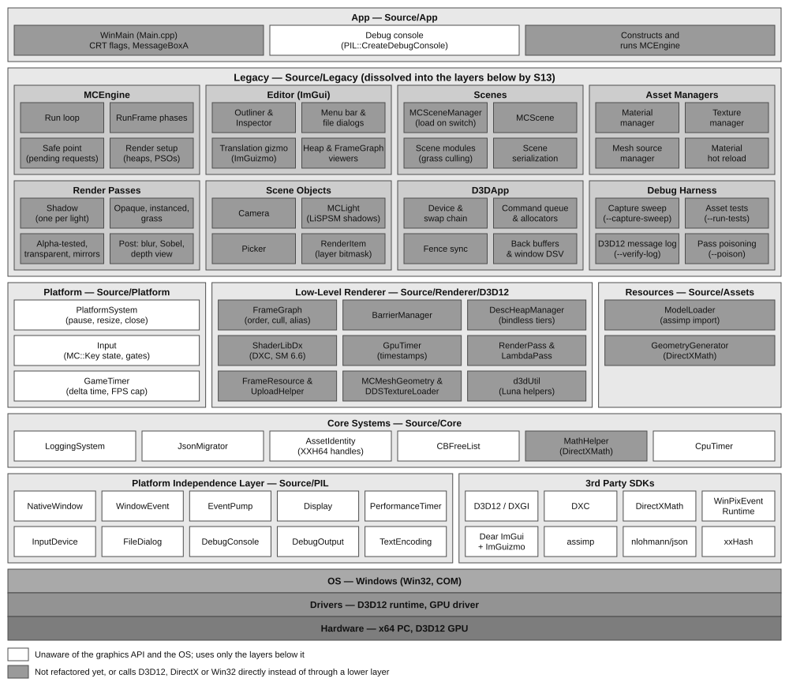

# MCEngine


A DirectX 12 rendering engine I am building to learn low-level graphics engine architecture.

<!-- Hero image: save a representative screenshot (recommended: the grass scene with post-FX on)
     as MC_Engine/Assets/readme/hero.png, then uncomment the line below. -->
 

*Active learning project. Windows + D3D12 only. API unstable; no release cadence.*

## Features

- Runtime HLSL compilation targeting Shader Model 6.x through DXC. Compiled shaders are held in an in-memory library; Debug builds write shader PDBs to `HLSL PDB/` for PIX.
- FrameGraph that orchestrates each frame as a graph of Render passes (per-frame pass culling, transient creation and aliasing).
- Per-layer PSO binning. Each render item carries a bitmask of render layers, and each forward pass draws one layer with its own PSO: Opaque, instanced grass, AlphaTested, AlphaTestedTreeSprites, Mirrors, Reflected, Transparent, OpaqueTessellated. Shadow maps are rendered from the Opaque layer.
- Post-processing Render passes that uses Compute Shaders via `dispatch` calls. (i.e. Blur, Sobel)
- Assimp-driven OBJ model import (`ModelLoader.cpp`).
- In-engine ImGui toolchain on the docking branch, including a live descriptor-heap visualizer.
- Explicit resource state-transition batching through `BarrierManager`.
- Stable, predictable GPU descriptor indices through `DescHeapManager` that are dynamicity-tiered.

## Build and run

Prerequisites:

- Visual Studio 2026 with the *Desktop development with C++* workload (platform toolset v145).
- Windows 10 SDK 10.0 or newer (whichever ships with Visual Studio is sufficient).
- A Direct3D 12-capable GPU.
- NuGet — used to restore the `WinPixEventRuntime` package referenced by `MC_Engine/packages.config`. The Visual Studio NuGet integration handles this automatically on first build; on the command line, use `msbuild -t:Restore` (shown below) or run `nuget restore MC_Engine\MC_Engine.sln` first.
- The `WinPixEventRuntime` NuGet package (`WinPixEventRuntime` 1.0.240308001) — pulled by the restore step above. It supplies the PIX runtime headers and `WinPixEventRuntime.lib` linked by the engine for GPU/CPU event instrumentation. Captures themselves are taken with the standalone PIX on Windows tool from Microsoft.

Build from the command line:

```
msbuild MC_Engine\MC_Engine.sln -t:Restore;Build /p:Configuration=Release /p:Platform=x64
```

Or open `MC_Engine\MC_Engine.sln` in Visual Studio and build `x64 | Release` (NuGet packages restore automatically on first build).

Run from the `MC_Engine` directory. Asset and shader paths are resolved relative to the working directory, and the Visual Studio debugger already uses this directory.

```
cd MC_Engine
x64\Release\MC_main.exe
```

The build copies the runtime DLLs from `MC_Engine\dll files\` next to the EXE:
- `dxcompiler.dll` and `dxil.dll`;
- the Assimp DLL: `assimp-vc143-mtd.dll` for Debug, `assimp-vc143-mt.dll` for Release.

The PIX runtime DLL (`WinPixEventRuntime.dll`) is copied by its NuGet package.

## Repository layout

```
01_repo/
├── MC_Engine/
│   ├── Assets/                  # HLSL shaders, DDS textures, fonts, models
│   ├── Source/                  # Engine sources, one directory per layer; includes are root-relative
│   │   ├── App/                 # Entry point (Main.cpp) and the icon resource
│   │   ├── PIL/                 # Platform independence layer: thin OS wrappers, one implementation file per OS (window and event pump, high-resolution timer, debug output, text encoding, file dialog, debug console, input device and engine key codes)
│   │   ├── Core/                # Logging, math helpers, CPU timer, asset identity, JSON migration, CB free list
│   │   ├── Platform/            # Window, event pump, input, game timer
│   │   ├── Renderer/D3D12/      # Descriptor heaps, barriers, GPU timer, runtime HLSL compilation (DXC), FrameGraph/
│   │   ├── Assets/              # Procedural geometry, Assimp OBJ import
│   │   └── Legacy/              # Files waiting for their layer: MCEngine, D3DApp, scenes, asset managers, passes, ImGui editor
│   ├── Includes/                # Vendored headers: Assimp, DXC, ImGui
│   ├── Libs/                    # Vendored static libs
│   ├── dll files/               # Runtime DLLs the build copies next to the EXE
│   ├── packages/                # NuGet packages (WinPixEventRuntime)
│   └── MC_Engine.sln
└── README.md
```

## Architecture at a glance

The engine is layered in the style of Gregory's *Game Engine Architecture* (ch. 1.6): each band may use only the bands below it. The audit (`Tools/audit.ps1`) enforces the include direction for `PIL`, `Core`, `Platform` and `Renderer`. Only `PIL` calls the OS (rule A14 for debug output). `Legacy` is not yet checked; the refactor moves its contents into the lower bands and an engine, editor and scene layer.



The goal is that nothing above the bottom layers knows which graphics API or OS it runs on. Today the third-party SDKs sit beside the PIL instead of under it, because code above calls D3D12, DirectXMath and Win32 directly; those boxes are grey. Grey also marks everything in `Legacy`, which is not refactored yet. The planned exceptions are the shaders, because bindless resources need SM 6.6 on D3D12, and the ImGui backends, which are OS- and API-specific by design and should still be reached through a lower layer.

**`D3DApp` (`MC_Engine/Source/Legacy/`).** The D3D12 base class taken from Frank Luna's demos, reduced in S4 to the device: device and swap-chain setup, command queue, triple-buffered command allocators, fence-based CPU/GPU synchronization, and per-frame constant buffers (pass, object, material). The window, message pump, input and timer moved to `PlatformSystem` and the PIL. Its helpers now sit in their layers: procedural geometry (`Assets/GeometryGenerator`), math helpers (`Core/MathHelper`), a DDS texture loader (`Renderer/D3D12/ThirdParty/`), and upload-heap staging utilities (`Renderer/D3D12/UploadHelper.h`).

**MCEngine (`MC_Engine/Source/Legacy/MCEngine.cpp`).** The application class, derived from `D3DApp`.
- **What it owns.** The descriptor heaps, root signatures, PSOs, scene render targets, frame resources, the frame graph and its passes, and the ImGui editor.
- **Assets.** Materials, textures and meshes are owned by `MCMaterialManager`, `MCTextureManager` and `MCMeshSourceManager`, keyed by 64-bit handles.
- **Scenes.** Render items live on the active `MCScene`. `MCSceneManager` loads it from JSON when the scene is switched.
- **Drawing.** Each render item carries a bitmask of render layers. Each forward pass in the frame graph draws one layer with its own PSO.
- **ImGui descriptors.** ImGui shares the main CBV/SRV/UAV heap through a reserved range of slots at its head.

**Shaders (`MC_Engine/Assets/Shaders/`).** All HLSL is compiled at runtime by DXC against Shader Model 6.x. Compiled PDBs land in `MC_Engine/HLSL PDB/` for debugger attachment.

## Notable systems

### DescHeapManager

`MC_Engine/Source/Renderer/D3D12/DescHeapManager.cpp` — central allocator for the GPU-visible CBV/SRV/UAV heap (and the RTV/DSV heaps). Descriptors are tiered.
- **Static tier.** Every persistent resource gets a stable, predictable index for its whole lifetime.
- **Dynamic tier.** Per-frame views for frame-graph transients, retired after the frames in flight complete.

Shaders read the indices directly through `ResourceDescriptorHeap[]` (Shader Model 6.6 bindless). Without the stability invariant, a reallocation after a resize silently breaks sampling for every view that moved. The manager addresses allocation, indexing, and lifetime as distinct concerns rather than one opaque heap.

### BarrierManager

`MC_Engine/Source/Renderer/D3D12/BarrierManager.cpp` — batches `D3D12_RESOURCE_BARRIER` records and flushes them at sync boundaries instead of emitting transitions per call site. Eliminates redundant transitions and avoids interleaved submission patterns the driver handles poorly. Current scope is intentionally narrow; broader resource-lifetime abstraction is on the roadmap.

### FrameGraph

`MC_Engine/Source/Renderer/D3D12/FrameGraph/FrameGraph.cpp` — orchestrates the frame as a graph of passes rather than a hand-ordered command sequence. Each `RenderPass` declares the resources it reads and writes in a `Setup` step; `Compile` derives execution order from those declarations, culls passes whose outputs go unused, computes transient-resource lifetimes, and aliases their memory (greedy interval coloring per heap class) so short-lived targets share allocations. `Execute` then replays the passes, inserting every state transition through `BarrierManager` and wrapping each pass in a PIX and GPU-timer scope. Adding a pass no longer means re-reasoning about global ordering and barriers — the pass states its own reads and writes, and the graph does the rest. It is the only render path. Every scene render pass runs through it:
- shadow maps;
- the forward layer passes;
- GPU grass culling;
- debug lines;
- MSAA resolve;
- the post-processing compute chain (Gaussian blur, Sobel);
- depth visualization.

### Shadow maps

`MC_Engine/Source/Legacy/MCLight.cpp` — one depth map per shadow-casting light, rendered by a `ShadowPass_<i>` frame-graph pass from the Opaque layer. Each light picks how its shadow volume is fitted:
- **`ORTHO_LIGHT`.** An orthographic box around a fixed bounding sphere, oriented to the light.
- **`PERSP_VIEW`** (the default). Fits the camera's view frustum instead, clipped to the scene's world-space bounds so no texels are spent outside the geometry, then applies a LiSPSM warp. The warp parameter defaults to the n_opt formula with a pseudo near plane, can be overridden per light, and fades out as the camera turns parallel to the light.

Depth bias is applied in world space, moving the lookup a fixed distance toward the light, so the same bias value holds under the orthographic and warped projections. Shadow coordinates and the direction to the light are computed in the vertex shader; the pixel shader does one hardware comparison sample (`SampleCmpLevelZero`, bilinear PCF).

## Roadmap

Phase 1 is complete. Work continues on two roadmaps: **System**, the engine's structure, and **Graphics**, its rendering features.

```mermaid
flowchart LR
  subgraph P1["Phase 1 — Foundations ✓"]
    direction TB
    BM["BarrierManager"]
    JS["JSON scene serialization"]
    ED["ImGui scene editor"]
    GT["GPU timestamp queries"]
    FG["Frame graph"]
    BM --> FG
  end

  subgraph SYS["System roadmap (active)"]
    direction TB
    subgraph RF["1. Refactor, independent of Luna's skeleton"]
      direction TB
      R0["S0–S1 Baseline captures, hygiene, Source/ layout"]
      R2["S2 Memory-safety fixes"]
      R3["S3 FrameGraph decoupling"]
      R4["S4 Platform extraction, run loop"]
      RL["PIL + OS-neutral logging<br/>(Core/LoggingSystem)"]
      R5["S5 Frame phases, one safe point<br/>(stop point 1)"]
      RM["Engine math types<br/>(Core/Math)"]
      R6["S6 Backend services"]
      R7["S7 Self-contained passes"]
      R8["S8 RHI, renderer boundary<br/>(stop point 2)"]
      R9["S9 Stream, CPU-only asset layer"]
      R10["S10 Entities, components, scene v2<br/>(stop point 3)"]
      R11["S11 Archetypes, diff-only save"]
      R12["S12 Editor system"]
      R13["S13 Close-out: MCEngine, D3DApp, legacy bridges deleted"]
      R0 --> R2 --> R3 --> R4 --> RL --> R5 --> RM --> R6 --> R7 --> R8 --> R9 --> R10 --> R11 --> R12 --> R13
    end
    SPLIT["MCCore / MCEditor / MCRuntime split"]
    CK["Offline asset cooker"]
    EX["Runtime export (.zip)"]
    DEMO["Sponza flythrough demo"]
    V1["v1.0 + demo reel"]
    R13 --> SPLIT --> EX
    CK --> EX
    EX --> DEMO --> V1
  end

  subgraph GFX["Graphics roadmap (in progress)"]
    direction TB
    LSP["LiSPSM shadow maps ✓"]
    DEF["Deferred rendering path"]
    PBR["Cook-Torrance PBR"]
    IBL["Image-based lighting"]
    CSM["Cascaded shadow maps"]
    CL["Clustered lighting"]
    AO["GTAO"]
    SP2["Sponza @ 60 fps / 1080p"]
    LSP --> CSM
    PBR --> DEF
    PBR --> IBL
    DEF --> CL
    IBL --> AO
    IBL & CSM & CL & AO --> SP2
  end

  FG --> R0
  R7 --> PBR
  R7 --> CSM
  R7 --> DEF
  GT --> SP2
  SP2 --> DEMO

  classDef done fill:#2e7d32,stroke:#1b5e20,color:#fff
  classDef wip fill:#f9a825,stroke:#f57f17,color:#000
  classDef todo fill:#455a64,stroke:#263238,color:#fff
  class BM,JS,ED,GT,FG,R0,R2,R3,R4,RL,LSP done
  class R5 wip
  class RM,R6,R7,R8,R9,R10,R11,R12,R13 todo
  class SPLIT,CK,EX,DEMO,V1 todo
  class DEF,PBR,IBL,CSM,CL,AO,SP2 todo
```



### Phase 1 — Foundations 

Instrumentation and abstractions every later item assumes. All items have shipped.

- ✓ Explicit resource state-transition batching through `BarrierManager`. A few raw `ResourceBarrier` calls remain outside it: back-buffer present transitions, the default-buffer upload helper, and the window depth buffer. State-tracking `CommandContext` extension (automatic `from`-state inference, cross-callsite merging, split barriers) is deferred until a measured cost demands it.
- ✓ JSON scene serialization. 64-bit asset handles (XXH64 of asset kind and name) back render-item references; `MCMaterialManager` / `MCMeshSourceManager` / `MCTextureManager` own asset lifecycle; `asset_redirects.json` resolves renames at load. Save, close, reopen, load → the scene is identical, and a hand-edit to the JSON survives a reload.
- ✓ ImGui scene editor surface — outliner + inspector + file menu (New / Open / Save / Save As) + ImGuizmo translation gizmo.
- ✓ GPU timestamp queries feeding rolling averages into ImGui UI. Every major pass reports GPU milliseconds. ~~cross-checked against PIX.~~
- ✓ Frame graph (render graph). Passes declare reads and writes; the graph computes execution order, transient-resource lifetimes (with aliasing), and barrier insertion automatically (using `BarrierManager`). Replaces hand-batched pass scheduling in `MCEngine::ForwardPass` and the post-process compute chain.

### System roadmap *(active)*

1. **Complete refactor, independent of Frank Luna's skeleton.** A staged restructure for readability, maintainability and modularity. It ends with no code left from the book's sample framework: `D3DApp`, `d3dUtil` and the `MCEngine` class built on them are replaced by the engine's own platform, backend and engine layers. It comes before most graphics work so new features land on clean seams. Every commit builds and matches the captured baseline. Each stage is listed with the state it ends in:
   - ✓ **S0–S3** — baseline captures; hygiene and the `Source/` layout; memory-safety fixes; the frame graph decoupled from `MCEngine`.
   - **S4–S5** *(S4 done, S5 in progress)* — platform and input extracted from `D3DApp`; the frame split into named phases with one safe point for GPU-affecting changes.
   - ✓ **Between S4 and S5** — a platform independence layer and OS-neutral logging. A thin `PIL` layer below `Core` wraps the OS (window and event pump, display query, high-resolution timer, input device, debugger output, text encoding, file dialog, debug console), with one implementation file per OS; `Core/LoggingSystem` is built on it, and engine code logs through `LoggingSystem` instead of calling `OutputDebugString` (audit rule A14). `PlatformSystem`, `Input` and `GameTimer` stay above `Core` and contain no OS code.
   - **Between S5 and S6** — engine math types. Engine-owned `Vec2`/`Vec3`/`Vec4`, `Quat` and `Mat4` in `Core/Math`, implemented on DirectXMath for now, so that no code outside `Core/Math`, the D3D12 backend and `Legacy` names DirectXMath. Their shape follows the CS529 engine's vector and matrix classes and the CS541 framework's transform functions; neither is copied.
   - **S6–S8** — backend services owned explicitly, passes that bind their own state, and an RHI: the frame graph, the passes and the `Renderer` interface written against engine-owned graphics types, with D3D12 as the one backend below them.
   - **S9–S11** — `Stream`-based serialization, a CPU-only asset layer, an entity–component object model replacing `RenderItem` (classic component composition, not ECS: an `Engine` that owns systems, scenes of entities composed of components), and prefabs (archetypes) with per-instance overrides.
   - **S12–S13** — the editor as its own system; `MCEngine`, `D3DApp` and the legacy bridges deleted.
2. Split into `MCCore` (static library, headless), `MCEditor` (ImGui host), and `MCRuntime` (shippable executable that never links ImGui or the debug layer).
3. Offline asset cooker: glTF 2.0 and PNG/HDR in, meshoptimizer-optimized binaries and BC-compressed DDS out. `MCRuntime` ships with zero Assimp.
4. Runtime export — an editor menu entry produces a `.zip` a reviewer downloads, unzips, and double-clicks.
5. Intel Sponza 2022 demo scene with scripted camera flythrough.
6. `v1.0` tag with a 90-second demo reel.

### Graphics roadmap *(in progress)*

1. ✓ LiSPSM shadow maps — the light's view frustum fitted to the camera frustum clipped to the scene bounds, with a light-space perspective warp and world-space depth bias (see [Shadow maps](#shadow-maps)).
2. Deferred rendering path — a G-buffer geometry pass and a full-screen lighting pass alongside the forward path, both scheduled by the frame graph.
3. Cook-Torrance metallic-roughness PBR, validated against Filament's matball at matched inputs.
4. Image-based lighting: diffuse irradiance cubemap, specular prefilter, BRDF LUT.
5. Cascaded shadow maps, four cascades with 5×5 rotated-Poisson PCF.
6. Clustered lighting on a 16×9×24 grid, point lights first.
7. GTAO at half resolution with temporal and spatial denoise, integrated into indirect diffuse.
8. Intel Sponza 2022 at locked 60 fps / 1080p, lit by the full stack.

## References

- Frank Luna, *Introduction to 3D Game Programming with DirectX 12* — starting-point sample structure.
- Microsoft **MiniEngine** (DirectX-Graphics-Samples) — resource management patterns.
- Microsoft **DirectX-Graphics-Samples** — DXC usage and bindless patterns.
- Jason Gregory, *Game Engine Architecture* — subsystem decomposition.
- Fabian Giesen, *The ryg blog* — GPU-side reasoning and micro-architecture intuition. https://fgiesen.wordpress.com/
- Yuriy O'Donnell, *FrameGraph: Extensible Rendering Architecture in Frostbite* — Frame Graph design patterns https://www.gdcvault.com/play/1024612/FrameGraph-Extensible-Rendering-Architecture-in
- Michael Wimmer, Daniel Scherzer, Werner Purgathofer, *Light Space Perspective Shadow Maps* (EGSR 2004) — the LiSPSM warp and its n_opt parameter.
- Marc Stamminger, George Drettakis, *Perspective Shadow Maps* (SIGGRAPH 2002) — the PSM path kept in `MCLight.cpp` for comparison.
- OGRE's LiSPSM shadow camera setup — fading the warp out as the view turns parallel to the light. https://github.com/OGRECave/ogre
- DigiPen CS529 engine framework — the `Engine` / system / entity–component / `Stream` structure the architecture refactor follows; reference implementation https://github.com/RyanXu02/CS529-Engine-Project

### Third-party libraries

- [Dear ImGui](https://github.com/ocornut/imgui) (docking branch) and [ImGuizmo](https://github.com/CedricGuillemet/ImGuizmo) — editor UI and gizmo.
- [Assimp](https://github.com/assimp/assimp) — OBJ model import.
- [DirectX Shader Compiler (DXC)](https://github.com/microsoft/DirectXShaderCompiler) — runtime HLSL compilation.
- [nlohmann/json](https://github.com/nlohmann/json) — scene and asset serialization.
- [xxHash](https://github.com/Cyan4973/xxHash) — 64-bit asset handles.
- [WinPixEventRuntime](https://www.nuget.org/packages/WinPixEventRuntime) — PIX CPU/GPU event markers.
- Microsoft's `DDSTextureLoader` and `d3dx12.h` helpers, as shipped with Frank Luna's samples (current versions: [DirectXTK12](https://github.com/microsoft/DirectXTK12), [DirectX-Headers](https://github.com/microsoft/DirectX-Headers)).

# Sources
- 다람디.obj / .dds — 3d model and texuture generated via Meshy.ai using character from [arca.live](https://arca.live/e/50851?target=title&keyword=%EB%8B%A4%EB%9E%8C%EB%94%94&p=1) emoji.
- all other textures files — directly taken from Frank Luna's demo samples.

## License
MIT.
